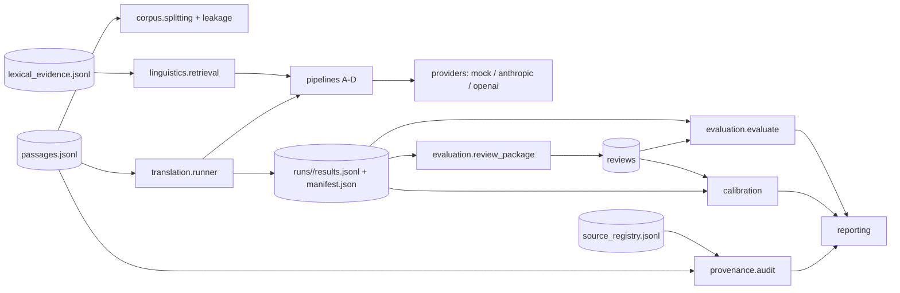

# Architecture

## Overview

## Layers

| Layer | Modules | Notes |
|---|---|---|
| Data model | `models/` | Pydantic v2, `extra="forbid"`. Validators enforce integrity: status evidence (`status_policy.py`), `SYN-` prefixes, diplomatic hash, category consistency, no imputed confidence. JSON Schemas generated by `schemas.py`. |
| Persistence | `utils/jsonl.py` | JSONL with line-numbered, field-level errors. CSV only for human exchange. TEI in `transcription/tei.py`. |
| Provenance | `provenance/` | `SourceRegistry` (load/register/promote/save), corpus audit. |
| Corpus | `corpus/` | Dataset hashing, statistics vs targets, grouped deterministic splitting with test lock, leakage checks, pilot selection. |
| Linguistics | `linguistics/` | Span-preserving tokenisation, clause splitting, heuristic language ID and morphology flags, local evidence retrieval (no vector DB). |
| Translation | `translation/` | Versioned prompt templates (package data), JSON response parsing, guardrails, pipelines A–D, runner (selection, held-out guard, manifest, ledger). |
| Providers | `translation/providers/` | Abstract base with retry/backoff, client-side rate limit, redacted logging, cost from configured prices. Mock (deterministic), Anthropic, OpenAI (optional extras). Factory enforces the paid-call guard. |
| Evaluation | `evaluation/` | MQM taxonomy and penalties, chrF/chrF++ (sacrebleu), optional COMET, bootstrap/Wilson, blinded packages, agreement, aggregation and staging comparison, labelled synthetic reviews for the demo. |
| Calibration | `calibration/` | Items from results + reviews, reliability bins, ECE/MCE/Brier/AURC, coverage–risk, abstention (refuses test-split tuning). |
| Reporting | `reporting/` | `string.Template` reports from `reports/templates/`, evidence banners, backlog model, milestone gate. |
| Interface | `cli.py`, `scripts/` | Typer CLI `nr`; scripts are thin wrappers. |

## Key decisions

See `docs/decisions/` (ADRs). In short: JSONL + Pydantic as the canonical store (reviewable diffs,
no database); research artifacts outside the package (found via repo-root discovery); providers
behind one interface, with the mock as default; integrity rules encoded as validators rather than
conventions.

## Extension points

- **New provider:** subclass `TranslationProvider`, implement `_send`, register in `factory.py`, add
  a config type.
- **New pipeline:** subclass `TranslationPipeline`, add templates and pins, register in `PIPELINES`.
- **New metric:** add to `evaluation/metrics.py:compute_metrics` behind a config flag.
- **QC3 (Milestone 2):** `ProposedInterpretation` already exists on passages, separate from
  `HistoricalAssertion`. An interpretation-evidence workflow will build on it without touching
  translation outputs.
